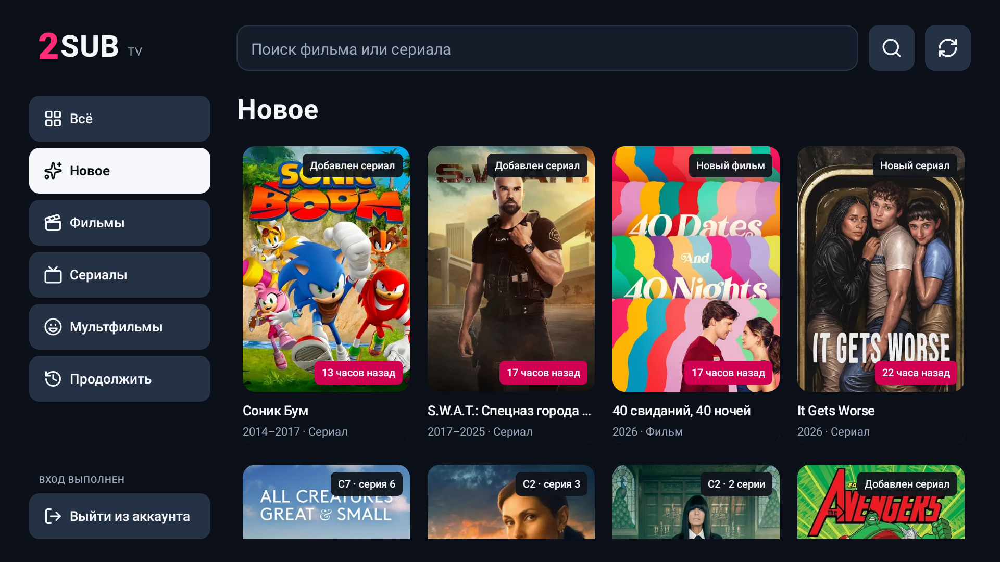
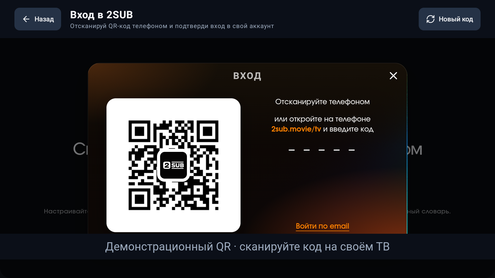
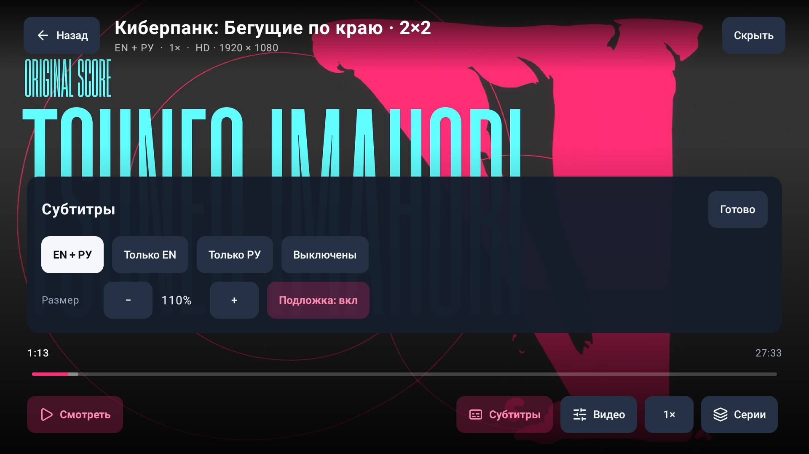
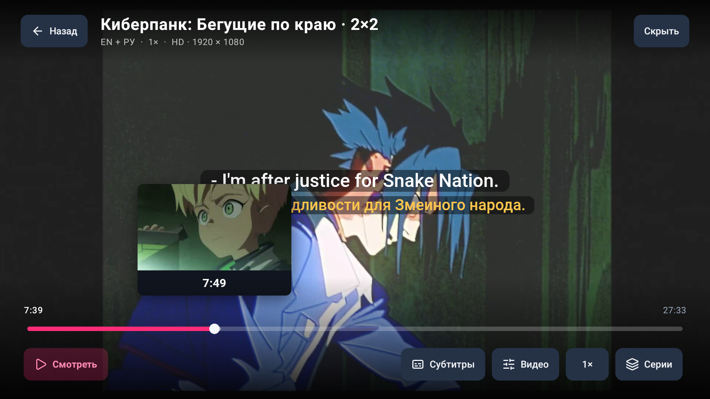
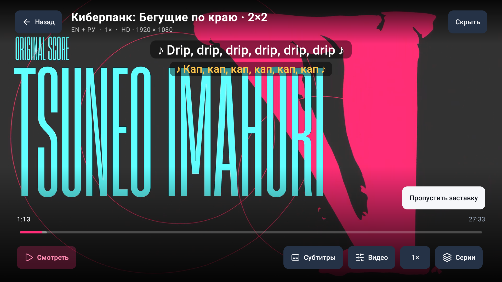
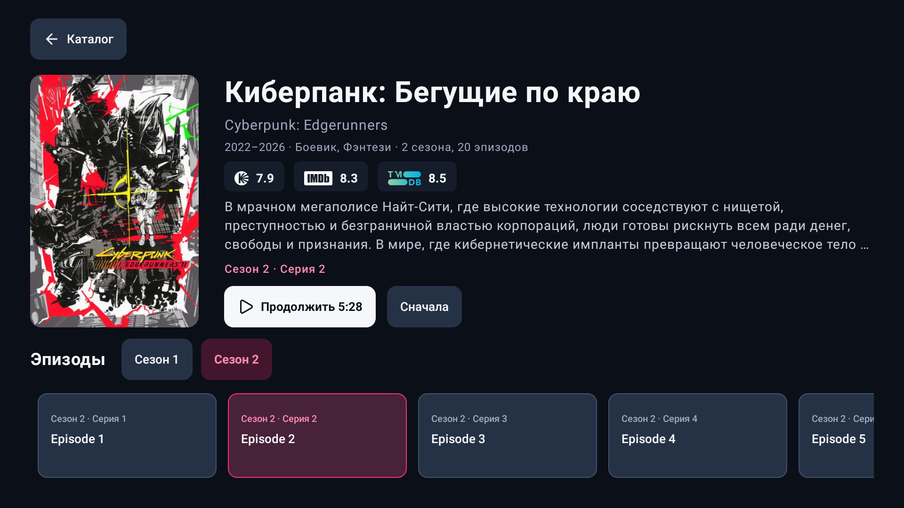
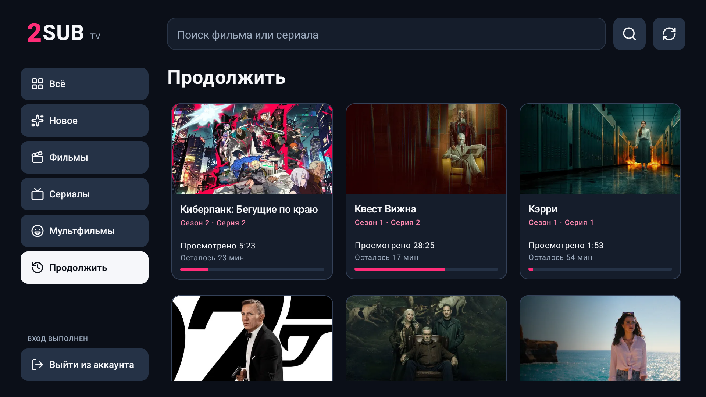
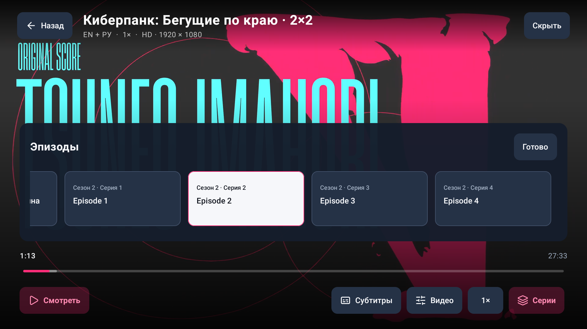
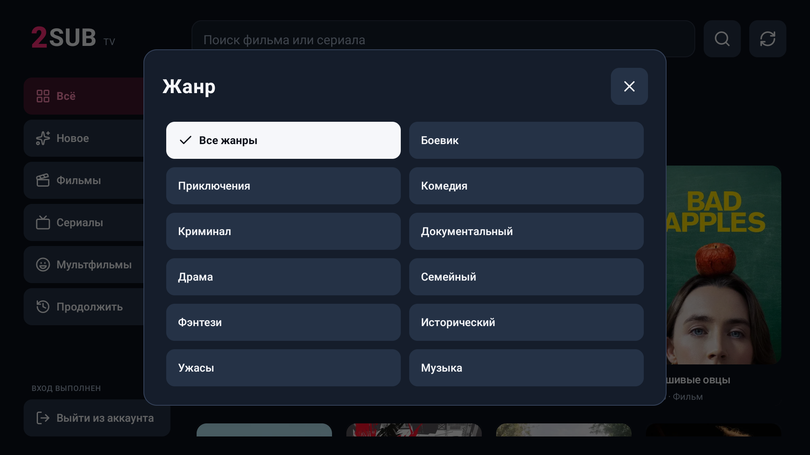

<div align="center">

# 2SUB TV

### Два языка. Большой экран. Один пульт.

Фильмы и сериалы [2SUB](https://2sub.movie/) в приложении для Android TV / Google TV.<br>
Вход по QR, английские и русские субтитры, интерфейс для телевизора.

[](https://github.com/zignifer/twosubstv/releases/latest/download/2sub-tv.apk)
[](docs/INSTALL.md#установить-через-codex)
[](https://2sub.movie/)

**[Вход и подписка](docs/ACCOUNT.md) · [Установка](docs/INSTALL.md) · [Решение проблем](docs/TROUBLESHOOTING.md) · [Изменения](CHANGELOG.md)**



</div>

> **Для использования нужен ваш аккаунт на [2sub.movie](https://2sub.movie/).** Полный доступ к каталогу зависит от подписки 2SUB. Само приложение бесплатно; подписку оформляют **на основном сайте**, отдельно от установки APK. Это независимый, неофициальный клиент.

## Войти — с телефона. Смотреть — на ТВ.

Пароль не нужно набирать пультом. Откройте **«Войти в аккаунт»**, отсканируйте QR-код камерой телефона и подтвердите вход на сайте 2SUB. Приложение вернётся в каталог, а сессия сохранится на телевизоре.



<sub>Скриншот настоящего экрана приложения. Для публикации QR заменён на ссылку на основную страницу входа, а одноразовый код скрыт. Сканировать нужно QR на вашем телевизоре.</sub>

Если камера не распознаёт QR, откройте **[2sub.movie/tv](https://2sub.movie/tv)** на телефоне и введите код с экрана ТВ. [Пошаговая инструкция →](docs/ACCOUNT.md)

## Сделано для просмотра с дивана

| | Что удобно на телевизоре |
| :-- | :-- |
| **EN + RU** | Оба языка, только английский, только русский или без субтитров. Размер и подложка регулируются с пульта. |
| **Продолжить** | История того же аккаунта 2SUB из браузера и с ТВ: последняя серия, прогресс и оставшееся время. |
| **Новое** | Видно, какие фильмы и серии добавили и сколько времени прошло. |
| **Выбрать фильм** | Поиск, жанры, сортировка и рейтинги Кинопоиска, IMDb и TMDB — когда они есть у сайта. |
| **Управлять пультом** | Крупные кнопки, заметное выделение, сезоны и серии в плеере. Без мыши. |
| **Найти момент** | Таймлайн с миниатюрами, ускорение при удержании стрелки и отмена выбранной позиции. Если у видео нет миниатюр, показывается время. |
| **Пропустить заставку** | Отдельная кнопка с фокусом, когда пропуск доступен в плеере сайта. |

### Субтитры, которые можно настроить под себя



### Выбрать нужный момент с пульта

Выберите таймлайн стрелками ↑/↓. Нажимайте ←/→ для шага на 10 секунд или удерживайте стрелку для ускорения. **OK** переводит к выбранному моменту, **Назад** отменяет выбор.



### Пропустить заставку

Когда у серии доступен пропуск, над таймлайном появляется отдельная кнопка. Её можно выбрать стрелками и нажать **OK**.



<table>
<tr>
<td width="50%"><br><b>Сначала выбрать.</b><br>Описание, оценки и эпизоды на одном экране.</td>
<td width="50%"><br><b>Потом продолжить.</b><br>История того же аккаунта из браузера и с ТВ.</td>
</tr>
<tr>
<td width="50%"><br><b>Следующая серия — рядом.</b><br>Переключайтесь прямо из плеера.</td>
<td width="50%"><br><b>Найти под настроение.</b><br>Жанры и сортировка без лишних настроек.</td>
</tr>
</table>

## Начать смотреть

1. **Подготовьте аккаунт.** Зарегистрируйтесь или войдите на [2sub.movie](https://2sub.movie/) с телефона. Для полного каталога оформите подписку на [странице тарифов](https://2sub.movie/prices/). [Как оплатить →](docs/ACCOUNT.md#подписка-и-оплата)
2. **Установите APK.** Скачайте [готовую сборку](https://github.com/zignifer/twosubstv/releases/latest/download/2sub-tv.apk) или передайте Codex запрос ниже.
3. **Подтвердите вход по QR.** Откройте 2SUB TV на телевизоре и войдите с телефона в тот же аккаунт.
4. **Выберите фильм или серию.** В плеере откройте «Субтитры» и задайте удобный режим.

### Запрос для Codex — можно скопировать целиком

```text
Установи 2SUB TV из https://github.com/zignifer/twosubstv на мой Android TV.
Прочитай AGENTS.md и docs/INSTALL.md. Найди мой телевизор среди доступных
устройств, проверь совместимость и установи официальный APK этого репозитория
из Releases с проверкой SHA-256. Если нужно сопряжение или QR-вход, скажи,
что подтвердить на ТВ или телефоне. При обновлении сохрани данные приложения.
Не меняй мой лаунчер, VPN и другие приложения.
```

Codex должен работать на компьютере, у которого есть доступ к вашему ТВ. Одной ссылки недостаточно для удалённого подключения: отладку и сопряжение подтверждает владелец устройства. [Полная инструкция и ручная установка →](docs/INSTALL.md)

## Пульт: всё необходимое

| Кнопка | Действие |
| :-- | :-- |
| **Стрелки** | Перемещение по каталогу, кнопкам и сериям |
| **OK** | Выбрать; при скрытом меню плеера — пауза / продолжение |
| **← / → в видео** | −10 / +10 секунд, когда управление скрыто |
| **← / → на таймлайне** | Выбор позиции; удержание ускоряет перемещение |
| **OK на таймлайне** | Подтвердить выбранную позицию |
| **↑ / ↓ в видео** | Показать управление |
| **Назад** | Отменить выбор позиции, закрыть панель, скрыть управление, вернуться к карточке |
| **Home** | Уйти на главный экран ТВ; видео ставится на паузу |

## Подойдёт ли моему ТВ?

**Android TV или Google TV, Android 8.0+**, актуальный Android System WebView, интернет и обычный пульт. Один universal APK; Google Play для установки не нужен. Проверено на Xiaomi MiTV-MOOQ0 с Android 11. Другие модели пока не проходили полный прогон. [Что именно проверено →](docs/VERIFICATION.md)

Телевизоры **Samsung Tizen, LG webOS и Apple TV** не устанавливают Android APK. К ним можно подключить совместимую Android TV / Google TV приставку.

## Несколько важных ответов

<details>
<summary><b>Это приложение от команды сайта 2SUB?</b></summary>

Нет. Это независимый клиент с собственным ТВ-интерфейсом. Каталог, аккаунт, доступ к просмотру и исходный веб-плеер предоставляет [2sub.movie](https://2sub.movie/). Доступа к серверу сайта у проекта нет. Изменения сайта могут потребовать обновления приложения.

</details>

<details>
<summary><b>За что платить и где?</b></summary>

APK бесплатный. У сайта есть ограниченный бесплатный доступ и платная подписка. Для полного каталога нужна подписка **2SUB**, приобретённая на [2sub.movie/prices](https://2sub.movie/prices/). Приложение не принимает платежи и не включает подписку. [Инструкция по аккаунту и оплате](docs/ACCOUNT.md).

</details>

<details>
<summary><b>Нужен ли VPN в России?</b></summary>

Сам по себе VPN не является обязательным требованием приложения. На проверенном ТВ короткие тесты проходили без него. Доступность и скорость зависят от провайдера, выбранного сервера сайта и видео. В панели «Видео» можно изменить доступное качество и сервер. [Что проверить при загрузках или зелёной полосе](docs/TROUBLESHOOTING.md).

</details>

<details>
<summary><b>История синхронизируется с сайтом? Есть словарь?</b></summary>

«Продолжить» загружает историю текущего аккаунта 2SUB с сайта и дополняет её локальными просмотрами ТВ. Войдите в один аккаунт на сайте и телевизоре. Позиция сохраняется штатным механизмом веб-плеера; при конфликте используется время сохранения, включая перемотку назад. Доступность истории зависит от сайта. Словарь, тренировки, избранное, скачивание и редактор текста реплик в этой версии не реализованы.

</details>

<details>
<summary><b>Как обновлять?</b></summary>

Установите новый APK из этого же репозитория поверх старого: `adb install -r`. Релизы подписываются постоянным ключом. Не удаляйте приложение: удаление стирает локальный вход и историю. Внутреннего автообновления пока нет. [Подробности](docs/INSTALL.md#обновление).

</details>

## Помощь и развитие

Нашли проблему интерфейса или совместимости? **[Создайте issue](https://github.com/zignifer/twosubstv/issues/new/choose)**: модель ТВ, версия Android, шаги и ожидаемый результат. Не прикладывайте пароли, cookies или действующий QR-код. Вопросы платежей и доступа к аккаунту решает поддержка основного сайта.

Для разработки: **Kotlin · Jetpack Compose for TV · Android WebView · Lucide**. [Сборка и проверки](docs/BUILD.md) · [Данные и конфиденциальность](docs/PRIVACY.md) · [Сторонние компоненты](NOTICE.md).

Код проекта — [MIT](LICENSE). Материалы каталога и товарные знаки принадлежат их владельцам. Проект не предоставляет собственную библиотеку видео и не меняет условия доступа 2SUB.

<div align="center">

**[Скачать 2SUB TV](https://github.com/zignifer/twosubstv/releases/latest/download/2sub-tv.apk)** · **[Перейти на 2SUB](https://2sub.movie/)**

</div>
